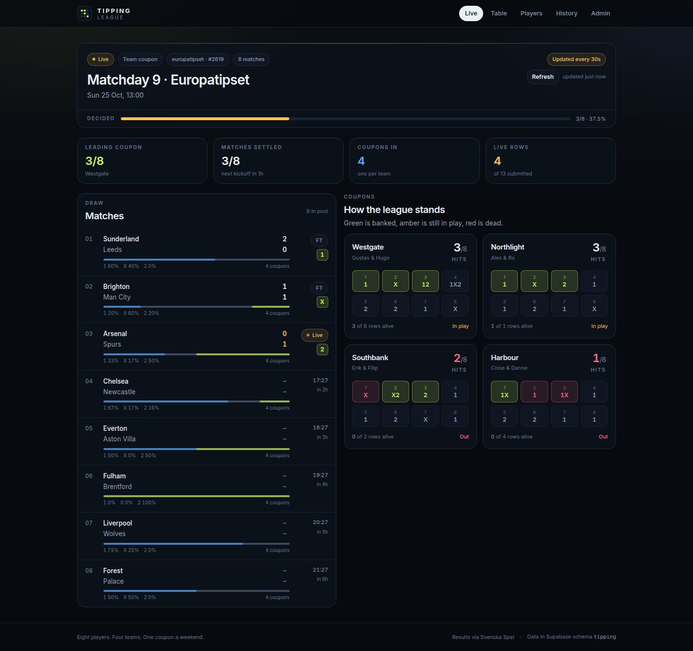
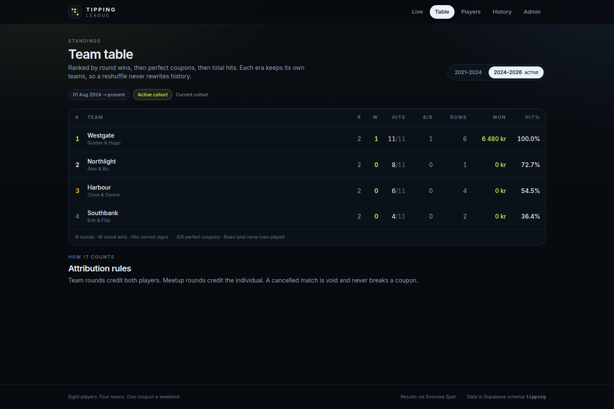
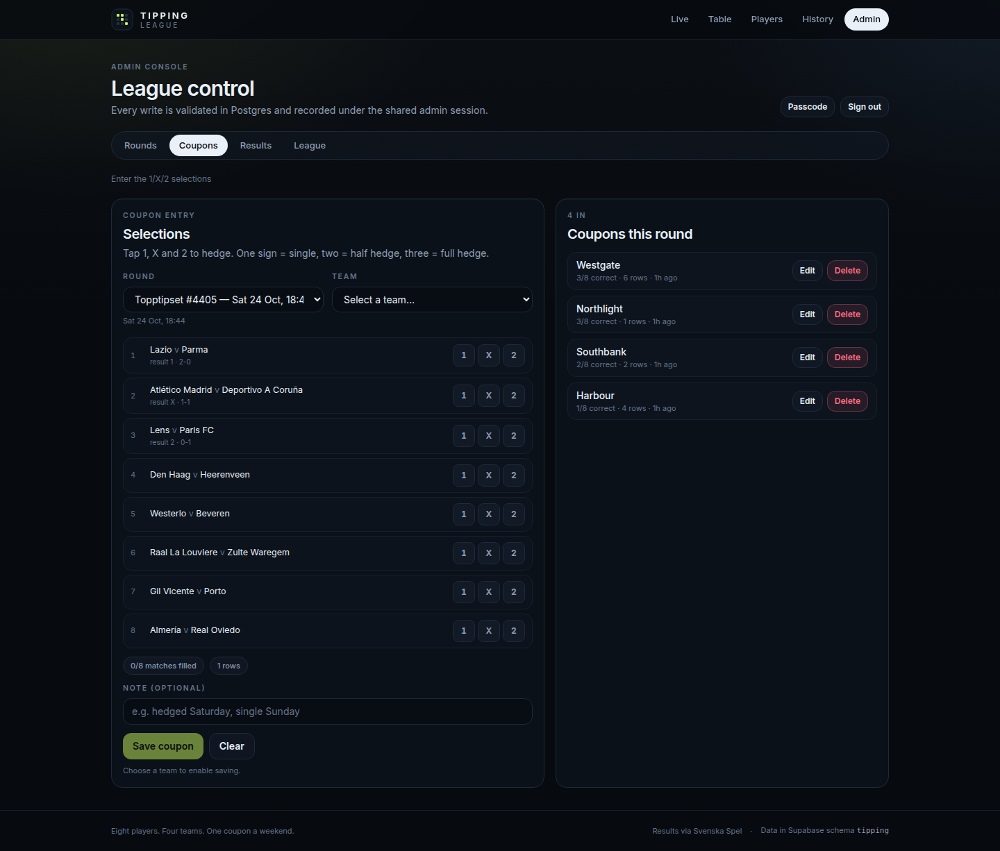
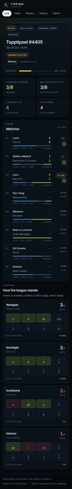

# Tipping League

A live board for a small football-pool league: eight players, four two-player teams, one
coupon a weekend (or eight solo coupons at a meetup). Fixtures, live scores and final
results come from **Svenska Spel**; the league's own data lives in an isolated
**`tipping`** schema on a shared Supabase instance.

**Stack:** Vite · React 19 · TypeScript (strict) · Tailwind CSS v4 · Supabase (Postgres + Edge Functions) · GitHub Pages.

**Live:** https://xel321123.github.io/tipping-league/

> The screenshots below are rendered from sample data in the QA harness, not real results.
> Players, teams and draws are seeded placeholders — rename them in Admin → League.

| Live board | Team table |
| --- | --- |
|  |  |

| Admin coupon entry | Mobile |
| --- | --- |
|  |  |


---

## Screens

| Route | What it does |
| --- | --- |
| `/` | Live board — the current round, match strip with live scores and community picks, every coupon colour-coded (green = banked, amber = in play, red = dead). When more than one round is live (a team round plus a meetup, or two draws) a switcher appears and the choice is kept in the URL as `?r=<round id>` so it can be shared |
| `/table` | Team standings for the selected era: wins, hits, perfect coupons, rows, **winnings**, hit % |
| `/players` | Individual stats across team coupons and meetup entries, with an era filter and a **Most won** sort |
| `/history` | Completed rounds by year, winners, and the team composition of each era |
| `/history/:id` | One round in full: matches, results, coupon breakdown |
| `/admin` | Passcode-gated console: rounds + draw sync, coupon entry, results/overrides, league structure |

---

## Quickstart

```bash
git clone https://github.com/<you>/tipping-league.git
cd tipping-league
npm install
cp .env.example .env        # fill in the two public values
npm run dev                 # http://localhost:5173
```

`.env`:

```dotenv
VITE_SUPABASE_URL=https://<project-ref>.supabase.co
VITE_SUPABASE_ANON_KEY=<publishable-or-anon-key>
```

Both values are public by design — the browser bundle contains them either way. **Never**
put a `service_role`/secret key or a database password in a `VITE_*` variable.

---

## Database setup

The app owns exactly one schema, `tipping`. It never reads or writes `public`.

### 1. Apply the migrations

**Clean, dedicated Supabase project:**

```bash
supabase link --project-ref <project-ref>
supabase db push                  # runs supabase/migrations/*.sql in order
psql "$DATABASE_URL" -f supabase/seed.sql
```

**Shared instance (this deployment):** `db push` refuses to run when the remote
migration history already contains another workspace's versions. Use the included
script, which executes the SQL through the Management API without writing history
entries:

```bash
export SUPABASE_ACCESS_TOKEN=sbp_...
supabase link --project-ref <project-ref>
./scripts/apply-migrations.sh --seed
```

No CLI? Paste the three migration files (`20261024120000`, `20261024120100`,
`20261024120200`) into the Supabase SQL editor in order, then `seed.sql`.

### 2. Expose the schema to the Data API

Dashboard → **Project Settings → API → Exposed schemas** → add `tipping` → save.
(Or via the Management API: `PATCH /v1/projects/<ref>/postgrest` with
`{"db_schema":"public,graphql_public,<existing>,tipping"}` — append, never replace.)

The client pins the schema (`db: { schema: 'tipping' }`), so every request carries
`Accept-Profile: tipping`. If you skip this step the app shows a clear error instead of
silently falling back to `public`.

### 3. Claim the admin passcode

The first login uses a public bootstrap passcode: **`tipping-bootstrap`**.

The moment you sign in, the app forces you to replace it — every other admin RPC stays
blocked until you do (`admin_config.must_change_passcode`). Sessions are random 256-bit
tokens, stored only as SHA-256 hashes, valid for 12 hours.

### 4. Deploy the draw proxy (recommended)

Svenska Spel's API sends **no** `Access-Control-Allow-Origin` header, so browsers on
GitHub Pages cannot read it. The included Edge Function is a read-only proxy:

```bash
supabase functions deploy ss-draw --project-ref <project-ref> --no-verify-jwt
```

The client tries the public API first and falls back to
`<project-url>/functions/v1/ss-draw?product=…&draw=…`. If both fail (rate limit, CORS,
outage) the admin panel still lets you enter fixtures and 1/X/2 outcomes by hand.

---

## Weekly runbook

1. **Admin → Rounds → New round.** Title, date, mode (`team` or `individual`), product
   (default `topptipset`), draw number (Topptipset needs it — see below), match count.
2. **Sync draw.** Fixtures, kickoffs and results are pulled and upserted. Re-syncing
   never overwrites an outcome you set manually.
3. **Coupons.** Pick the round, pick team/player, tap `1` `X` `2` per match. One sign =
   single, two = half hedge, three = full hedge. Rows are derived by Postgres.
4. **Results.** Sync during the round for live scores; leave the Results tab open and it
   auto-syncs every 60 seconds (the live board then refreshes every 30 s from the
   database). Override any match by hand — score, status, outcome — if the API lags.
   Round status is derived: all outcomes → `completed`.
5. Table, players and history update automatically.
6. **Record winnings.** After the round settles, open Admin → Results → *Coupon payouts* and
   enter what each coupon actually returned. Team payouts count for both players.

**Starting fresh.** Admin → League deletes eras, teams and players. Deleting an era
cascades its teams; an era that still has coupons, or a player who is still in a team, is
protected with an explanatory message — delete those rounds first. Renaming a player keeps
their history.

Adding a team: each player can hold **one team per era**, so the player pickers grey out
anyone already paired in the selected era (shown as `— in Northlight`). To re-pair someone,
edit that team or create a new era. The form reports problems right under the button, and
the page-level notices appear as a fixed toast so they are visible wherever you are scrolled.

### Install it as an app

`public/manifest.webmanifest` declares `display: standalone`, a scoped `start_url`, maskable
icons and app shortcuts; `public/sw.js` caches the shell so the board opens offline (the
Supabase data still needs a connection). iOS needs the `apple-mobile-web-app-capable` meta
tags, which are in `index.html` — that is what hides Safari's URL bar.

- **Android/Chrome:** menu → *Add to Home screen* (or the install icon in the address bar).
- **iOS Safari:** Share → *Add to Home Screen*, then open it from the icon.
- **Desktop Chrome/Edge:** install icon in the address bar.

Opened from the home-screen icon it runs full screen with no URL bar. The service worker is
registered in production builds only, and it never caches Supabase or Svenska Spel requests.

### Winnings: why they are entered, not fetched

Svenska Spel's API exposes the draw, the fixtures, live scores, turnover (`currentNetSale`),
row price (`rowPrice`) and rollover (`fund`) — but **not the payout**. There is no
result/payout endpoint, and Topptipset pays a single variable prize group (8/8 rows, 70% of
stakes) whose per-row amount is only published on the site. So the app stores one number
per coupon (`coupons.winnings`), aggregates it per team, per player and per era, and shows
it in the table, the player cards and the admin payout panel.

### The three Topptipset pools (product matters)

Topptipset is not one pool — Svenska Spel runs three 8-match pools that **share one draw
number series**, so the number alone is ambiguous:

| Product | API path | spela.se id | Example draw | What it was |
| --- | --- | --- | --- | --- |
| Topptipset | `topptipset` | 25 | 986 | AIK–Östersund (2018) |
| Topptipset Stryk | `topptipsetstryk` | 23 | 986 | Chelsea–Tottenham (live) |
| Topptipset Extra | `topptipsetextra` | 24 | 986 | Chelsea–Bournemouth |

A round therefore stores **product + draw number**, and the admin form makes you pick the
product (`Topptipset`, `Topptipset Stryk`, `Topptipset Extra`, plus Europatipset,
Stryktipset and Måltipset). Each round shows its pool in the round list and on the live
board, with a `on svenskaspel.se` link that resolves to the exact result page — e.g.
`…/topptipset/resultat?draw=986&product=23`. If a round comes back with the wrong fixtures,
the product is almost always the reason.

Svenska Spel's API no longer serves the **collection** endpoint
(`GET /draw/1/topptipset/draws` → *"No route found"*), so every Topptipset round carries a
draw number. Europatipset and Stryktipset (13 matches) still resolve "latest draw" on their
own. Saving a round with a draw number now pulls the fixtures immediately.

---

## Data model

```
players ──┐                         team_eras (one active at a time)
          ├── teams (era_id, player_1_id, player_2_id)
          │        └── coupons (round_id, team_id) ── coupon_selections (match_number, signs[])
rounds ───┤
          └── round_matches (match_number 1..13, home/away, kickoff, scores, outcome)

coupons (round_id, player_id) ── coupon_selections        ← individual/meetup mode
```

* **Eras** pin team composition to a date range. Reshuffling creates a new era; old
  coupons keep pointing at the old team rows, so history never mutates.
* **Rounds** store the Svenska Spel product + draw id/number, so a round always resolves
  against the draw it was played on — even if members targeted different draws.
* **`coupon_selections.signs`** is a validated `text[]` subset of `{1,X,2}` (1–3 values,
  no duplicates). `coupons.total_rows` is a trigger-maintained product of the sign counts.
* **`rounds.status`** is derived from its matches, never hand-maintained.

### Scoring (single source of truth: SQL views)

* A match is **resolved** when it has a final `outcome` or a live `current_result`.
* A coupon **hit** = at least one of its signs matches the resolved result.
* **Rows alive** = product of signs on unresolved matches; `0` as soon as a resolved match
  is missed. Perfect = every match resolved and hit.
* A **cancelled** match is void: it counts as neither hit nor miss and never breaks a coupon.
* Team coupons credit **both** players; individual coupons credit the player.

Views: `v_coupon_scores`, `v_pick_distribution`, `v_team_stats`, `v_player_stats`,
`v_round_winners` — all `security_invoker`, so RLS applies to the caller.

---

## Security model

| Layer | Rule |
| --- | --- |
| Client | Public anon/publishable key only; no writes to tables |
| RLS | Enabled on every table; `SELECT` policies for `anon`/`authenticated`; no write policies |
| Grants | `SELECT` on league tables + statistics views; no `INSERT/UPDATE/DELETE` for client roles |
| Writes | Only via `SECURITY DEFINER` functions in `tipping`, gated by a 12-hour admin token |
| Secrets | bcrypt passcode hash, SHA-256 session hashes; the session token never touches a table in plaintext |
| Validation | Match numbers, sign sets, round/team era consistency, coupon/round mode consistency — all enforced in Postgres |

The admin API is reachable by `anon` but every function immediately calls
`assert_admin(token)`; without a valid session it raises and changes nothing.

---

## Deployment

### GitHub Pages (included)

`.github/workflows/deploy.yml` builds with `GITHUB_PAGES=true` (base path
`/tipping-league/`) and publishes `dist`. It also copies `index.html` to `404.html` so
deep links boot the SPA.

```bash
gh variable set VITE_SUPABASE_URL --body "https://<ref>.supabase.co"
gh variable set VITE_SUPABASE_ANON_KEY --body "<publishable-key>"
gh api -X POST repos/<owner>/tipping-league/pages -f build_type=workflow
```

Repository **variables**, not secrets — both values are public. To use a different repo
name, update `base` in `vite.config.ts` (or set `GITHUB_PAGES` off and host at root).

### Vercel

Import the repo, framework preset **Vite**, add the same two env vars, build `npm run build`,
output `dist`. No `GITHUB_PAGES` variable. Add a rewrite of all paths to `/index.html` for
client-side routing.

---

## Scripts

| Command | Purpose |
| --- | --- |
| `npm run dev` | Vite dev server |
| `npm run build` | Typecheck + production build (`dist/`) |
| `npm run typecheck` | `tsc --noEmit` |
| `npm run verify:schema` | Run migrations + seed in PGlite (real Postgres/WASM) and assert 49 schema, RLS, scoring and auth behaviours |
| `python3 scripts/gen-icons.py` | Regenerate app icons (stdlib only) |
| `./scripts/apply-migrations.sh [--seed]` | Apply migrations on the shared instance (no history collision) |
| `supabase db push` | Apply migrations on a dedicated project |
| `supabase functions deploy ss-draw` | Deploy the CORS proxy |

## Project docs

* [`PROJECT_PLAN.md`](PROJECT_PLAN.md) — architecture, decisions, API surface, risks
* [`TASKS.md`](TASKS.md) — phased roadmap and definition of done
* [`AGENTS.md`](AGENTS.md) — conventions for contributors and coding agents

---

## Troubleshooting

**"The `tipping` schema is not reachable through the Data API"**
Add `tipping` under Project Settings → API → Exposed schemas. The app deliberately
refuses to fall back to `public`.

**Sign-in says "Invalid passcode"**
The bootstrap is `tipping-bootstrap`. If it was already rotated and forgotten, reset it:

```sql
update tipping.admin_config
   set passcode_hash = extensions.crypt('new-passcode', extensions.gen_salt('bf', 10)),
       must_change_passcode = false;
delete from tipping.admin_sessions;
```

**"Live draw sync unavailable"**
Either the Edge Function is not deployed (`supabase functions deploy ss-draw
--no-verify-jwt`) or Svenska Spel is rate limiting. Enter fixtures and outcomes manually in
Admin → Results; a later sync will not overwrite them.

**Topptipset returns "No route found"**
That upstream route is currently gone (see the note above). Use `europatipset`,
`stryktipset` or `maltipset`, or set up the round manually with `match_count = 8`.

**Deep links 404 on GitHub Pages**
Confirm the deploy produced `dist/404.html` (the Vite plugin copies it) and that Pages is
built from the Actions workflow, not from a branch.

